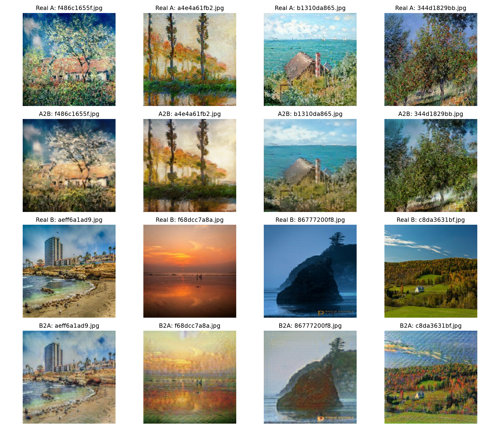
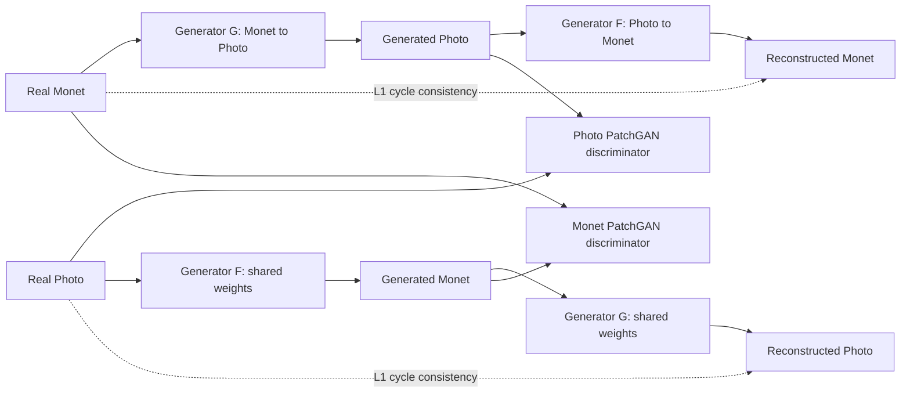
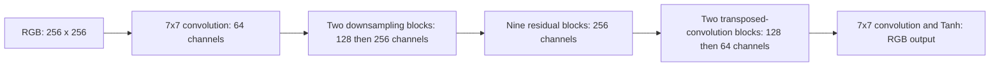
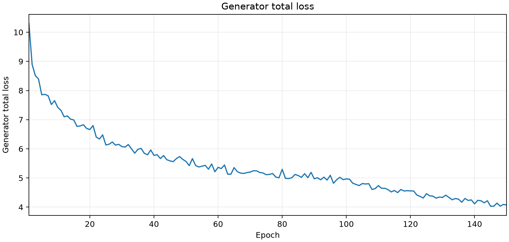
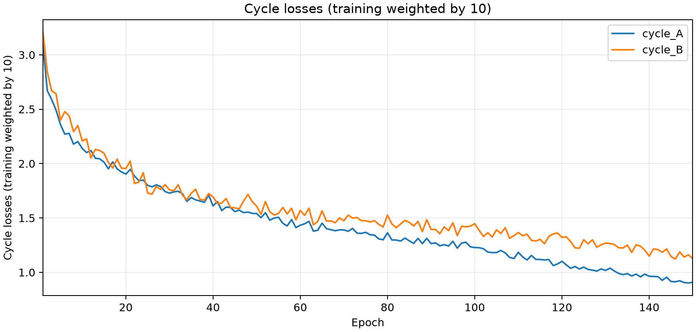

# CycleGAN Monet Style Transfer

**Unpaired image-to-image translation between photographs and Monet paintings, built with PyTorch.**

Implemented and trained a CycleGAN with two ResNet generators and two PatchGAN discriminators to learn translation in both directions without paired training images. The recorded experiment completed **150 epochs / 45,000 steps** on an **NVIDIA GeForce RTX 4090**. Evaluation combines distribution metrics, cycle reconstruction, perceptual similarity, and a two-rater human assessment.

[Training notebook](notebooks/train_cyclegan.ipynb) · [Model implementation](src/models.py) · [Metrics](reports/metrics.csv) · [Setup](SETUP.md)

## Visual results



Each column shows a saved example. **Rows 1–2:** Monet input and translated photo. **Rows 3–4:** photo input and translated Monet-style image. A = Monet; B = Photo. This is the existing fixed-sample grid, copied without image retouching; it illustrates both style changes and remaining artifacts, not the entire evaluation set.

The translations often preserve broad scene layout while changing color and texture. Fine details can blur, and some outputs retain features of the input domain. The images show the trained model's behavior, rather than an idealized style-transfer mockup.

## What I built

- **Unpaired data pipeline:** independent image sampling, RGB preprocessing, resize/crop/flip augmentation, and normalization to [-1, 1].
- **Bidirectional CycleGAN:** two ResNet-9 generators with InstanceNorm and two 70×70 PatchGAN discriminators.
- **Training objectives:** least-squares adversarial loss, L1 cycle consistency, and identity loss.
- **Training controls:** Adam optimization, learning-rate scheduling, gradient/NaN monitoring, checkpoint saving and resumption, and fixed-sample visualization.
- **Evaluation:** FID, MiFID, KID, generative precision/recall, cycle-reconstruction L1, LPIPS, and content-feature cosine similarity.
- **Human evaluation:** saved ratings for 30 translations, two raters, three quality dimensions, and inter-rater agreement.

## Architecture

The generators learn opposite mappings. Cycle consistency encourages a translated image to reconstruct its input when passed through the reverse generator. The discriminators compare translated outputs with real images in their respective target domains.



### Generator design



InstanceNorm and ReLU follow the generator's intermediate convolution layers. Each PatchGAN produces local real/fake scores rather than one whole-image classification. Identity loss additionally encourages each generator to preserve images already in its target domain.

| Component | Configuration | Parameters |
|---|---|---:|
| Monet → Photo generator | ResNet-9 | 11,378,179 |
| Photo → Monet generator | ResNet-9 | 11,378,179 |
| Monet discriminator | 70×70 PatchGAN | 2,764,737 |
| Photo discriminator | 70×70 PatchGAN | 2,764,737 |
| **Total** | **Four networks** | **28,285,832** |

## Training configuration

| Setting | Recorded run |
|---|---|
| Training images | 300 Monet paintings; 7,038 photos |
| Input resolution | 256×256 RGB |
| Augmentation | Resize to 286×286, random 256×256 crop, horizontal flip |
| Optimizer | Adam, learning rate 0.0002, betas (0.5, 0.999) |
| Batch size / precision | 1 / float32 |
| Cycle / identity loss weights | 10 / 5 |
| Completed training | 150 epochs; 300 steps per epoch |
| Learning-rate schedule | Constant through epoch 100, then linear decay toward epoch 200 |
| Seed | 171 |
| Replay buffer | Disabled |

Each Monet image is used once per epoch; photos are sampled independently with replacement. A 200-epoch learning-rate schedule does not imply 200 completed training epochs.

## Comparison: translation directions

The recorded evaluation uses **300 images per set**. These are two directions of the same model, not results from separate competing architectures.

| Metric | Monet → Photo | Photo → Monet |
|---|---:|---:|
| FID ↓ | 109.4891 | 105.8679 |
| MiFID | 0.43110 | 0.41312 |
| KID, unscaled mean ↓ | 0.02509 | 0.01022 |
| Generative precision ↑ | 0.64333 | 0.35000 |
| Generative recall ↑ | 0.30000 | 0.61333 |
| Input/translation content cosine ↑ | 0.82844 | 0.78282 |

Photo→Monet has lower FID and KID and higher generative recall. Monet→Photo has higher generative precision and content cosine. The target distributions differ, so the numbers describe tradeoffs rather than establish one universally better direction. Comparisons with other systems require matching sampling, preprocessing, and feature extraction.

## Comparison: epoch 100 vs. epoch 150

| Aggregate evaluation score | Epoch 100 | Epoch 150 | Change |
|---|---:|---:|---:|
| Mean bidirectional FID | 112.4341 | 107.6785 | −4.7556 |
| Aggregate MiFID | 0.423133 | 0.422113 | −0.001020 |

These saved checkpoint measurements show a **4.23% reduction in aggregate FID**. The epoch-150 aggregate FID is the mean of the two directional FIDs. This is a comparison within the recorded experiment, not a benchmark against another model.

## Human evaluation

Thirty fixed translations—15 per direction—were rated by two people on a 1–5 scale. Higher scores indicate better quality, including fewer artifacts for the artifact-quality score.

| Dimension | Monet → Photo | Photo → Monet |
|---|---:|---:|
| Style quality | 4.00 | 3.33 |
| Content preservation | 4.17 | 3.90 |
| Artifact quality | 3.60 | 3.27 |

The overall recorded score is **3.711/5**, with mean weighted Cohen's kappa **0.674**. Human ratings favor Monet→Photo even though Photo→Monet has lower FID, illustrating why distribution metrics and visual assessment are both useful. The audit is small and should not be treated as a population-level quality estimate.

[Rating summary](outputs/human_audit/human_audit_summary.csv) · [Directional ratings](outputs/human_audit/human_audit_by_direction.csv)

## Training behavior





These saved plots show the recorded training behavior. Adversarial losses are not direct image-quality scores, so evaluation also uses the fixed examples and quantitative measurements above.

## Hardware and efficiency

| Measurement | Recorded value |
|---|---:|
| GPU | NVIDIA GeForce RTX 4090, approximately 24 GB VRAM |
| Logged training duration | 91.63 minutes |
| Epoch-150 input throughput | 16.81 images/sec |
| Peak allocated training memory | 2.45 GiB |
| Recorded NaN / Inf totals | 0 / 0 |

Throughput counts both input domains: 600 images per epoch. Allocated memory is not total device memory usage. These measurements are specific to the recorded run and are not hardware-independent guarantees.

## Limitations and next steps

- Outputs can contain texture artifacts, blurred detail, or incomplete changes in style. See [failure analysis](reports/failure_analysis.md).
- Evaluation uses 300 images per set; scores are sensitive to sample selection and implementation details.
- LPIPS measures input versus cycle reconstruction, not similarity to a paired ground-truth target.
- Checkpoint weights and complete prediction folders are not bundled, so inference is not immediately available from this repository alone.
- The evaluated notebook uses seed 171; the separate Python configuration uses 266. Use the notebook configuration to reproduce the reported run.
- The notebooks were reorganized and outputs cleared. Their edited versions have not been rerun end-to-end.

Potential follow-up experiments include replay buffers, alternate upsampling, and discriminator regularization. These are proposed experiments, not implemented improvements.

## Run locally

See [SETUP.md](SETUP.md) for environment and data requirements. After setup, open the training notebook:

```powershell
cd notebooks
python -m jupyterlab
```

Open `train_cyclegan.ipynb`. Training switches are disabled by default; review setup and evaluation cells before running. Put the image domains in `data/monet_jpg/` and `data/photo_jpg/`. The dependency list is not a tested environment lock.

```text
assets/         # saved translation grid and training plots
notebooks/      # training and evaluation notebooks
src/            # models, data pipeline, losses, training, evaluation
reports/        # metrics and analysis
outputs/        # human-rating tables
SETUP.md
requirements.in
```

## Technical skills demonstrated

**Python · PyTorch · Computer Vision · Generative Adversarial Networks (GANs) · CycleGAN · Image-to-Image Translation · Unpaired Learning · ResNet · PatchGAN · GPU Training · Image Preprocessing · Perceptual Evaluation · FID · KID · LPIPS · Experiment Analysis**
